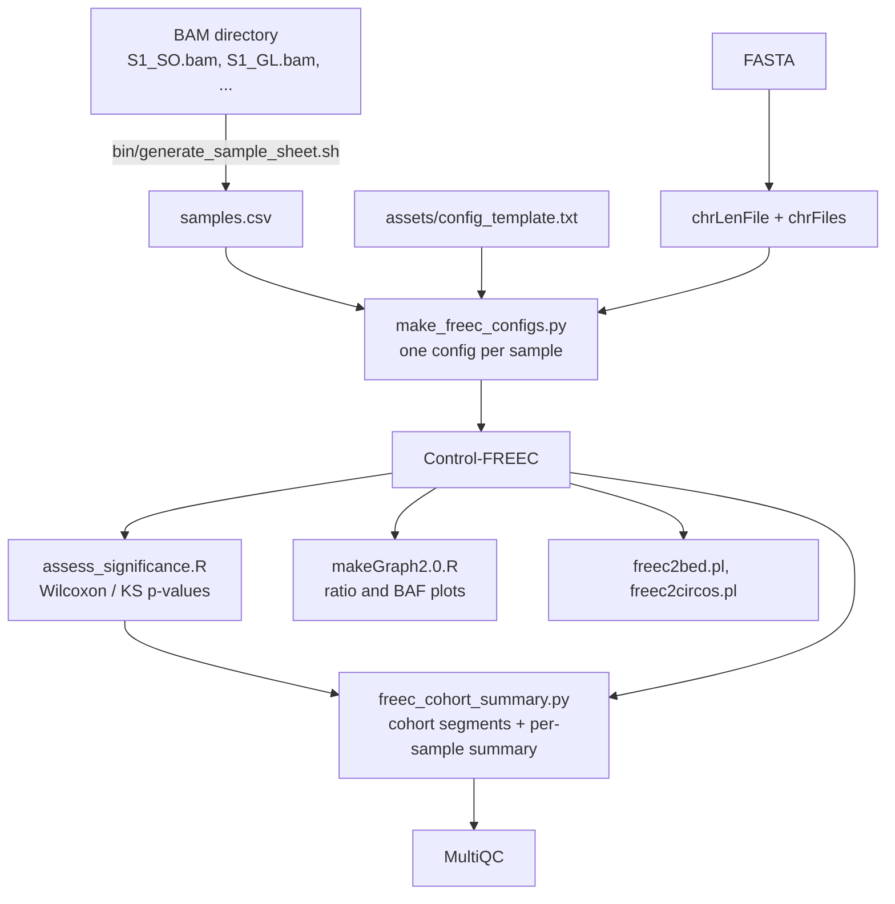

# cnv-controlfreec-batch

[](https://github.com/bioinfosourabh/cnv-controlfreec-batch/actions/workflows/ci.yml)
[](https://www.nextflow.io/)
[](LICENSE)

Copy-number calling with [Control-FREEC](https://github.com/BoevaLab/FREEC) for many samples at once. Control-FREEC is driven by one configuration file per sample; this repository generates those files from a **sample sheet and a single template**, runs FREEC on every sample, adds the significance tests, plots and BED/Circos exports from the FREEC distribution, and merges all calls into cohort tables.

It handles tumour-normal pairs and tumour-only samples, exome/panel data (with a capture BED) and whole genomes, with or without B-allele frequencies (BAF).

There are two ways to run it, sharing the same sample sheet and template:

- **Nextflow pipeline** (`main.nf`): containerised, parallel, resumable; for clusters and cloud.
- **Bash scripts** (`bin/`): for a single server with FREEC installed, no workflow manager needed.

## Workflow



## Sample sheet

```csv
sample_id,tumor_bam,normal_bam,sex
S1,/data/S1_SO.bam,/data/S1_GL.bam,XY
S2,/data/S2_SO.bam,,XX
```

- `normal_bam` empty = tumour-only analysis (the `[control]` section is left out of that sample's config, and GC-content normalisation defaults are used).
- Extra columns override template placeholders for that sample only, for example `contamination` or `ploidy`:

  ```csv
  sample_id,tumor_bam,normal_bam,sex,contamination,ploidy
  S1,/data/S1_SO.bam,/data/S1_GL.bam,XY,0.4,2
  ```

`bin/generate_sample_sheet.sh -d /data/bams` builds the sheet from a folder of BAMs by pairing `<id>_SO.bam` (tumour) with `<id>_GL.bam` (normal); the suffixes are options, `-a` adds tumours without a normal, and sex is inferred from the chrY read fraction unless set with `-s`.

## Config generation

`assets/config_template.txt` is an ordinary Control-FREEC config with `{{NAME}}` placeholders. `bin/make_freec_configs.py` fills them per sample from, in order of precedence, the sample sheet, `--set NAME=VALUE`, the reference-file options, and defaults that depend on the analysis mode:

| Placeholder | tumour-normal | tumour-only | exome (capture BED) | genome |
|---|---|---|---|---|
| `WINDOW` | | | 0 (one window per target) | 50000 |
| `NOISY_DATA` | | | TRUE | FALSE |
| `READ_COUNT_THRESHOLD` | | | 50 | 10 |
| `DEGREE` / `INTERCEPT` | 1 / 0 (control normalisation) | 3 / 1 (GC normalisation) | | |
| `CONTAMINATION`, `PLOIDY`, `THREADS` | 0.25, 2, 4 | | | |

Lines whose placeholders are empty are dropped, and sections marked `#@requires NAME` are dropped when `NAME` is empty, so the same template serves every mode. Unknown placeholders are an error, which catches typos in the template.

The script works on its own:

```bash
bin/make_freec_configs.py -s samples.csv -t assets/config_template.txt -o configs \
    --chr-len hg38.len --chr-files hg38_chromosomes/ \
    --capture-bed exome_targets.bed --snp-file common_snps.vcf.gz --fasta hg38.fa \
    --output-dir 'results/{sample_id}'
```

## Quick start: Nextflow

```bash
# bundled simulated data (one pair, one tumour-only sample, known gain and loss)
nextflow run bioinfosourabh/cnv-controlfreec-batch -profile test,docker --outdir results_test

# exome tumour-normal cohort
nextflow run bioinfosourabh/cnv-controlfreec-batch -profile docker \
    --input samples.csv --outdir results \
    --fasta Homo_sapiens_assembly38.fasta \
    --capture_bed exome_targets.bed
```

`chrLenFile` and the per-chromosome FASTA directory (`chrFiles`) are built from `--fasta` (chromosomes 1-22, X, Y by default; see `--contig_regex`) unless given with `--chr_len` / `--chr_files`. Add `--snp_vcf` for BAF and genotypes (see Limitations for targeted data). `--freec_set WINDOW=50000,CONTAMINATION=0.3` overrides template values for all samples. All parameters are in [nextflow_schema.json](nextflow_schema.json) and [docs/usage.md](docs/usage.md).

## Quick start: Bash

```bash
cp conf/freec_batch.conf.example freec_batch.conf    # set FREEC_BIN, reference paths
bin/generate_sample_sheet.sh -d /data/bams -o samples.csv
bin/run_controlfreec_batch.sh -s samples.csv -c freec_batch.conf -o results -j 4
```

Each finished step leaves a marker in `results/.steps/<sample>/`; re-running the command skips completed steps and re-runs a sample whose config has changed. `-n` writes the configs only.

## Output

```
results/
├── configs/<sample>.config.txt     generated FREEC configs
├── samples/<sample>/
│   ├── <sample>_CNVs               CNV segments (chr, start, end, copy number, status[, genotype, uncertainty])
│   ├── <sample>_CNVs.p.value.txt   with Wilcoxon and Kolmogorov-Smirnov p-values
│   ├── <sample>_ratio.txt          normalised copy-number ratio per window
│   ├── <sample>_BAF.txt            B-allele frequencies (with SNPs)
│   ├── <sample>.CNV.bed, <sample>.circos.txt
│   └── plots/*.png
├── cohort/
│   ├── cohort_cnv_segments.tsv     all segments, all samples
│   └── cohort_cnv_summary.tsv      per sample: gains, losses, copy-neutral LOH, altered bases, fraction of genome altered
├── multiqc/multiqc_report.html
└── pipeline_info/
```

Details: [docs/output.md](docs/output.md).

## Testing

- `pytest tests/` (20 tests) covers config generation (tumour-normal, tumour-only, exome/genome defaults, per-sample overrides, BAF section, sheet validation) and the cohort summary.
- `shellcheck bin/*.sh` passes.
- CI also runs `nextflow lint` and stub runs of the test profile in genome and exome mode.
- The test data are simulated by [tests/make_test_data.py](tests/make_test_data.py) with a 60 kb single-copy gain and a 60 kb one-copy loss with LOH (`tests/data/truth_cnv.tsv`). Running the Nextflow pipeline and the Bash runner on them outside containers (Control-FREEC 11.6b built from source with the Bioconda patches, samtools 1.21) recovered both events in both tumours, including the AAB / A genotypes when BAF was used. The R steps (significance, plots) were not run in that check because R was not available; in the containers they come from the BioContainers Control-FREEC image.

## Notes on the FREEC settings

The default values in the template are the exome tumour-normal settings this tool was built for (`window = 0`, `minCNAlength = 3`, `breakPointThreshold = 0.6`, `breakPointType = 2`, `coefficientOfVariation = 0.05`, `contamination = 0.25`, `readCountThreshold = 50`). Two details of FREEC 11.6b matter here:

- With a capture BED and `window = 0`, FREEC normalises by GC content and needs `chrFiles` (or a GC profile); without it, it stops with an error. The template therefore always sets `chrFiles`.
- `makePileup` in the `[BAF]` section must be a file of SNP positions (VCF or BED), not `TRUE`; FREEC uses the value as a path. The template sets it to the SNP file.
- `contamination` is the fraction of normal cells in the tumour sample (1 - purity).

## Limitations

- BAF on targeted data needs `bedtools` inside the FREEC container (FREEC restricts the SNP positions to the capture regions with `bedtools intersect`). The BioContainers image has samtools but not bedtools, so the pipeline refuses `--snp_vcf` together with `--capture_bed` unless `--freec_container` points to an image that has it; `containers/freec-bedtools/Dockerfile` builds one. Without bedtools, FREEC continues silently with incomplete BAF.
- Sex inference in `generate_sample_sheet.sh` uses a chrY read-fraction threshold that depends on the assay; check it or set sex explicitly.
- Copy-number calls from tumour-only exome data are less reliable than tumour-normal calls; FREEC has no matched normal to remove capture bias.
- CRAM input is not supported by the Nextflow pipeline.

## Tools

| Tool | Use | Reference |
|---|---|---|
| Control-FREEC 11.6b | CNV and BAF calling, significance, plots, exports | Boeva et al. 2012, *Bioinformatics* 28:423 |
| samtools 1.21 | FASTA index, BAM index, pileups (inside FREEC) | Danecek et al. 2021, *GigaScience* 10:giab008 |
| MultiQC 1.30 | report | Ewels et al. 2016, *Bioinformatics* 32:3047 |
| Nextflow | workflow manager | Di Tommaso et al. 2017, *Nature Biotechnology* 35:316 |

## License

MIT, see [LICENSE](LICENSE). Control-FREEC itself is GPL-2.0-or-later and is used from its containers, not redistributed here.

## Author

Sourabh Kumar · bioinfosourabh@gmail.com · https://bioinfosourabh.netlify.app · ORCID https://orcid.org/0009-0009-5840-9830
